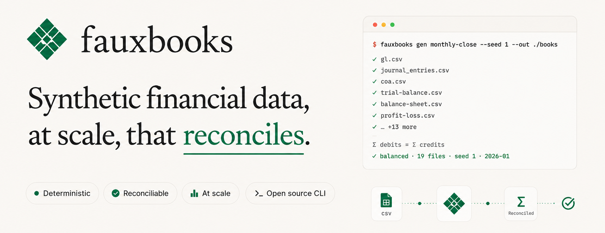

<p align="center">
  
</p>

<hr />

[](https://github.com/humzakhan/fauxbooks/actions/workflows/ci.yml)
[](LICENSE)
[](go.mod)

**fauxbooks** is an open-source Go CLI that generates deterministic, reconcilable synthetic
double-entry accounting datasets. Each run produces a complete set of balanced financial files
from a seeded event stream — GL, bank statement, sub-ledgers, financial reports. The same seed,
bundle, period, and version produce byte-identical output across runs, operating systems, and
CPU architectures.

## Install

```bash
go install github.com/humzakhan/fauxbooks/cmd/fbx@latest
```

Requires Go 1.24 or later. No CGo. Single static binary.

Build from source: see [CONTRIBUTING.md](CONTRIBUTING.md).

## Quickstart

```bash
# Generate a monthly-close dataset for January 2026 (seed 1, small volume, CSV)
fbx gen monthly-close --seed 1 --period 2026-01 --volume small --out ./output

# Verify all four invariants against that output
fbx verify ./output

# Convert a CSV file to XLSX
fbx convert --in ./output/gl.csv --out ./gl.xlsx
```

## Subcommands

| Subcommand | Description |
|---|---|
| `fbx gen` | Generate a synthetic financial dataset for a given bundle, seed, and period. |
| `fbx verify` | Re-run invariant checks against an existing output directory. |
| `fbx convert` | Convert a single file between CSV, XLSX, and JSONL formats (all six directions). |
| `fbx mcp` | Start a JSON-RPC 2.0 MCP server on stdin/stdout (tools: `fbx_gen`, `fbx_verify`, `fbx_docs_list`, `fbx_bundle_list`). |
| `fbx version` | Print the binary version string. |

## Formats and bundles

**Output formats:** `csv` (default), `jsonl`, `xlsx` (single workbook), `pdf` (8 report files).

**Built-in bundles:**

| Bundle | Description |
|---|---|
| `monthly-close` | Standard month-end close — all four invariants hold; suitable for testing and ML training. |
| `recon-stress-test` | Same event mix with injected anomalies (timing diffs, duplicates, orphans); `fbx verify` exits 2 by design. |

**Custom bundles and templates:** pass `--bundle-config <path.yaml>` or `--templates-config <path.yaml>` to override the built-in event mix or journal-entry templates.

## Determinism

The same `--seed`, bundle, `--period`, `--volume`, and fbx version produce byte-identical output
across runs, operating systems, and CPU architectures. No wall-clock reads in the generation path;
all timestamps derive from `--period`.

## Documentation

| Resource | Contents |
|---|---|
| [`docs/usage.md`](docs/usage.md) | Full CLI/MCP reference: flags, output files, formats, YAML schemas, exit codes, examples. |
| [`docs/`](docs/) | Index of all documentation: thesis, product spec, and the full reference. |
| [`CONTRIBUTING.md`](CONTRIBUTING.md) | Build from source, test workflow, CI policy, contribution guidelines. |
| [`plans/roadmap.md`](plans/roadmap.md) | Planned features (v0.3+) and out-of-scope items. |

## License

This project is licensed under the MIT License.
See [LICENSE](LICENSE) for details.
